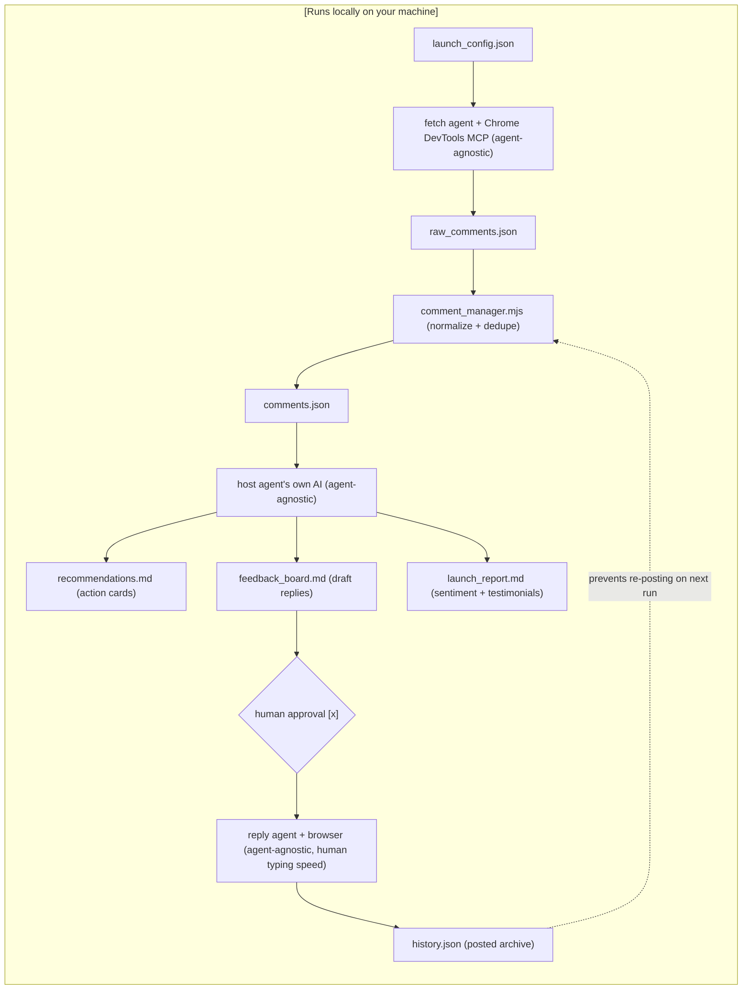

# Launch Intelligence — Local-First Community Feedback Pipeline

Launch Intelligence is a closed-loop feedback pipeline for indie hackers: you launch a product on social platforms and it turns the community's comments into action cards, replies, and a daily report. Everything runs **locally on your machine** — a real logged-in browser, driven by any AI agent, with a small Node.js script for bookkeeping. No n8n, no cloud, no VPS, no API keys for the social platforms.

The pipeline works because it is local-first: a real browser with your real logins scrapes comments and posts replies, and a small Node.js script (the CLI) keeps state so nothing is ever posted twice. A cloud server **cannot** do this reliably — social platforms are login-walled, and datacenter/cloud IPs are flagged and rate-limited, so the same VPS that powers your AI Daily Briefing is exactly the wrong place to scrape comment threads or post replies.

## What the pipeline does

1. **FETCH** — Any AI agent (Claude Code, Gemini CLI, Cursor, or any MCP-capable agent) opens your launch URLs in a **real logged-in browser** via Chrome DevTools and extracts the comments (author, text, permalink, platform) into `raw_comments.json`.
2. **NORMALIZE + DEDUPE** — `comment_manager.mjs` ingests the raw comments and keeps only new ones by deduping against `history.json`.
3. **ANALYZE** — The **host agent does the AI itself**: it reads `prompts/analyze.md` and `comments.json`, then uses its own built-in model to write three files: `recommendations.md` (action cards), `launch_report.md` (sentiment + testimonials), and `feedback_board.md` (draft replies). No API keys, no separate model — **the AI is the tool you are already running in.**
4. **HUMAN REVIEW** — You edit the drafts and mark `[x]` to approve each reply you want posted.
5. **REPLY** — The agent opens each approved comment's permalink in the real browser, types the reply at human speed, and records it as posted in `history.json`.

The only external runtime is Node.js — and it does **zero AI**. The AI for every stage (fetch guidance, analysis, reply drafting, posting) **is the agentic tool you are running the pipeline inside of** (Claude Code, Gemini CLI, Cursor, or any MCP-capable agent with Chrome DevTools). The agent can be any agent; the browser can be any real browser you are logged into. The repository commits no API keys and calls no external model APIs.



The whole loop inside the box runs on your machine. The two labeled agent boxes and the analysis LLM are all **agent-agnostic** — any agent that can drive Chrome DevTools and run a Node.js command works.

## Quickstart

One launch = one folder under `runtime/launches/`. The steps:

1. **Create the launch folder and config.** Create `runtime/launches/<launch-id>/`, copy `workflows/launch-intelligence/templates/launch_config.json` into it, and replace the sample `id` / `platform` / `url` / `title` / `published_at` entries with your actual launch posts.
2. **Fetch.** Open `workflows/launch-intelligence/prompts/fetch.md` and run that instruction verbatim in your browser-capable agent. It reads `launch_config.json`, opens every URL in a real logged-in browser tab, scrolls and speaks the comments, and writes `raw_comments.json`.
3. **Normalize + dedupe.** Run the `comment_manager.mjs` **ingest** command against the launch folder (exact command shape comes from the script help; see below). It produces `comments.json` and updates the dedupe state.
4. **Analyze.** Give `prompts/analyze.md` to the same (or any) agent. Its own AI reads `comments.json` plus `history.json` and writes `recommendations.md`, `feedback_board.md`, and `launch_report.md` — no external model call needed, the agent IS the model.
5. **Review the board.** Open `feedback_board.md`, edit any draft text, and mark the rows you want posted as `[x]` (approved). Rows stay `[*]` (pending) until you approve them.
6. **Reply.** Give `prompts/reply.md` to the same agent. It posts **only** approved rows in the real browser at human typing speed, then runs the `comment_manager.mjs` **`mark-posted`** command, appending each to `history.json`.
7. **Verify.** Open `launch_report.md` for the sentiment summary and testimonials, `recommendations.md` for the action cards, and check `history.json` to confirm each reply is recorded exactly once.

## The CLI

Command syntax for the pipeline's bookkeeping is **canonical and defined by the script itself**. Run this once during setup to get the authoritative list of commands and their flags:

```bash
node workflows/launch-intelligence/scripts/comment_manager.mjs --help
```

The script's core commands are:

| Command | Role in the pipeline |
| --- | --- |
| `ingest` | Reads `raw_comments.json`, normalizes, dedupes against `history.json`, writes `comments.json` (Step 3). |
| `board` | Reads / prints the current `feedback_board.md` state and the outstanding reply queue. |
| `reply-approve` | Toggles one draft reply between `[*]` (pending) and `[x]` (approved). |
| `mark-posted` | Records a successfully posted reply in `history.json` so it is never posted twice (Step 6). |
| `status` | Summarizes the launch: comments ingested, pending vs approved vs posted replies, dedupe counts. |

Do not guess flags — the `--help` output is the source of truth. If anything in this README disagrees with the script help, the script wins.

## Folder structure

```text
workflows/launch-intelligence/        # COMMITTED — the reusable pipeline
├── README.md                         # this file
├── prompts/                          # agent instructions, the source of truth for agents
│   ├── fetch.md
│   ├── analyze.md
│   └── reply.md
├── scripts/                          # comment_manager.mjs (the CLI)
├── templates/                        # launch_config.json template
└── examples/                         # sample outputs (recommendations.sample.md, launch_report.sample.md)

runtime/launches/<launch-id>/         # NEVER COMMIT — gitignored, live per-launch data
├── launch_config.json                # your real launch post URLs
├── raw_comments.json                 # raw scrape output from the fetch stage
├── comments.json                     # normalized, deduped comments
├── history.json                      # dedupe + posting ledger
├── feedback_board.md                 # draft replies (the human review queue)
├── recommendations.md                # action cards
└── launch_report.md                  # sentiment summary + testimonials
```

Commit `README.md`, `prompts/`, `scripts/`, `templates/`, and `examples/` — they are the reusable pipeline. **Never** commit `runtime/` (it is gitignored): live comments, history, and boards are your private per-launch data and contain account information.

## Why a local browser?

Every stage that touches the platform runs in your **real, logged-in browser**. The design is intentional:

- **Bot detection.** Scraping and posting in a real Chrome session looks like a human inside a browser; a headless scraper or an API pump is fingerprintable and blocked.
- **Cloud-IP reputation.** VPS and cloud IP ranges are widely flagged and rate-limited by social platforms. Your home connection's IP is not.
- **Login-walled pages.** X, LinkedIn, Reddit, and most comment threads require an authenticated session to show comments at all. Your browser already has those cookies.
- **Human typing speed.** Replies are typed with human-like pacing, which is far less likely to be treated as automation than an instant burst.
- **Multi-platform reliability.** One browser handles every platform the same way — no API tokens, no SDKs, no per-platform workarounds, no endpoints that break when the platform changes.

## Why not n8n for this?

n8n is a great automation surface, but this pipeline deliberately does not use it. Cloud-hosted n8n cannot reliably scrape login-walled social platforms, and it cannot post replies from inside a logged-in browser without a cloud-IP flag. Running fetch and reply locally means your own cookies, your own IP, and your own typing pace. n8n stays in this repository exactly where it is strong: the **AI Daily Briefing** workflow (`workflows/ai-intelligence/ai-daily-briefing`) — scheduled scraping of public news sources and Slack alerts, which need no login. The looping mechanics of Launch Intelligence are simpler than a workflow engine: a config file, three prompts, and one Node.js script.

## Agent-agnostic

The pipeline is not tied to any one AI agent, model, or browser:

- **Claude Code / CLI agents** — run the prompt files directly and drive Chrome via Chrome DevTools MCP.
- **Gemini CLI** — same prompt files, same MCP browser integration.
- **Cursor / IDE agents** — same prompt files, without you leaving the IDE.
- **n8n-based agents** — anything that can read/write files in `runtime/` and drive Chrome DevTools.

Each prompt in `prompts/` is **self-contained**: the agent does not need this README, the repo history, or any other state to execute a stage. The only technical requirement is **Node.js** (to run `comment_manager.mjs`), and any browser tool that exposes a *browser tab you are already logged into*. The output schema is defined inside each prompt, so any agent produces identical artifacts.

## Ways of working

- **`prompts/` is the source of truth for agents.** If a stage changes, update the prompt file, not the conversation with the agent. Re-running an updated prompt must be the fix, not re-prompting in chat.
- **`runtime/` stays local.** It contains raw scrapes, your draft replies, and your post ledger. Never pushes it to git; never passes it to a cloud service.
- **Human-in-the-loop is a gate, not a suggestion.** The analysis drafts replies; only you approve them; the reply stage posts only `[x]` rows.
- **The script is the ledger of record.** Whatever `history.json` says has already been posted — the reply stage and dedupe both trust it.